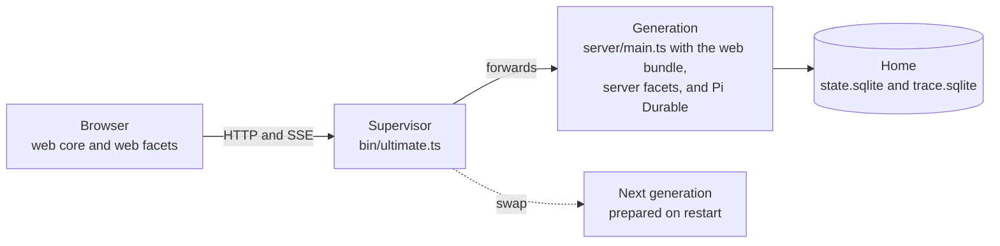

# Architecture

This file says how Ultimate is built: its processes, its layers, where its state lives, and how a change goes live. A code map follows. The mechanics stay in `AGENTS.md` and `docs/`, and this file links to them.

## Processes

- The supervisor, `bin/ultimate.ts`, is a long-lived process. It holds the public port and `ultimate.lock`. It forwards to one generation. It restarts a generation after a crash (`docs/running.md`)
- A generation, `server/main.ts`, is one core process. It serves the web UI as a production bundle, loads the extensions, and opens the Pi Durable harness (`docs/running.md`). A short-lived child process builds the bundle, so the memory of the build leaves with the child (`47c08a50`, `server/web-build.ts`)
- Each browser tab uses one `/api/events` connection for all subscriptions (`27e615d0`, `70f56ce5`). The SDK manages this stream and sends actions to `server/api.ts` (`web/src/sdk/store.ts`)
- A preview runs `server/main.ts` on its own port and uses its own home. It has no supervisor, so it cannot restart (`docs/running.md`)
- `17d186bf` removes the unused emergency terminal agent. Supervisor diagnostics remain in `bin/ultimate.ts` ([Running the server](../running.md))
- Script triggers, lander checks, and previews run as child process groups (`lib/process-group.ts`, `extensions/automations/supervisor.ts`)
- MCP servers use child processes for stdio or remote HTTP connections (`5eae312d`, `extensions/mcp/server.ts`)
- The supervisor no longer displays a service report (`6e9cd78d`). It displays the Tailscale URL above the local URL (`fc77dee5`)
- One small helper process starts the host's child processes, so a launch does not copy the host's memory map (`4b314408`, `lib/spawn.ts`)

## Layers

The layers go from the foundation up. A layer depends only on the layers below it. `pnpm check` enforces the boundaries between extensions (`AGENTS.md`).

1. **Pi and Pi Durable.** Durable conversations, tasks, hooks, and providers. The packages are pinned, and `patches/` holds local patches ([Borrowed from Pi](../pi-upstream.md))
2. **Core.** `server/` holds the harness, the storage, the HTTP API, discovery, and the web bundle. `shared/protocol.ts` holds the contracts between server and browser
3. **Web core.** `web/` holds the surface host and its primitives, the SDK, the transcript, the composer, and the palette
4. **Core tier.** The extensions that are always on. Each depends only on the core tier. [Core tier](../extensions/core-tier.md) names them
5. **Optional built-ins.** The other built-ins. They reach the core tier through points or events
6. **Personal and project extensions.** Folders in `~/.ultimate/extensions/`, and in `<project>/.ultimate/extensions/` for a trusted project. A later folder with the same name replaces an earlier one

Three folders sit beside the layers. `lib/` holds helpers that extensions share and imports no extension (`AGENTS.md`). `agents/` and enabled extensions' `agents/` folders hold built-in definitions (`ab959a36`, `lib/agents.ts`). `skills/` holds skills that the prompt lists and the agent reads on demand (`extensions/prompt/server.ts`, `server/skills.ts`).

## Where state lives

- **The home** of a project, under `~/.ultimate/projects/` unless `ULTIMATE_HOME` sets it (`docs/running.md`):
  - `state.sqlite`: conversations, tasks, and documents of the active chapter (`docs/durability.md`)
  - `trace.sqlite`: the call trace (`server/trace.ts`)
  - `ultimate.lock`, `storage.lock`, and `supervisor.log`: the supervisor and the storage owner (`bin/ultimate.ts`)
  - `project.json` and `conversations.json`: the manifest that other projects read (`docs/durability.md`)
  - `chapters.json`, `chapters/`, and `pending-chapter.json`: the other chapters and a pending switch (`lib/chapters.ts`)
  - `lander/` and `worktrees/`: integration and conversation checkouts, unless project settings choose another path (`2affc7ad`, `extensions/workspaces/README.md`)
  - `web/`: the built web bundles (`47c08a50`), `attachments/`: uploaded files for 30 days (`80016496`), and `wire/`: raw model calls when Wire is on (`9b8f1866`)
- **The user layer**, `~/.ultimate/`: `settings.json`, `trust.json`, `secrets.json`, `health.json`, `AGENTS.md`, `skills/`, `agents/`, `extensions/`, and `automations/`, which holds user script triggers and the state of all script triggers (`docs/settings.md`, `extensions/automations/README.md`, `extensions/secrets/README.md`, `extensions/health/README.md`). `model-families.json` holds project family choices and recent choices (`741ec0da`, `lib/families-settings.ts`)
- **Pi**, `~/.pi/agent/`: logins, models, and settings that Ultimate shares with Pi. Each machine logs in separately (`README.md`)
- **The project**, `.ultimate/` in the repository: committed settings, extensions, agents, and skills (`docs/settings.md`). Project script triggers live in `<project>/.ultimate/automations/<slug>/` (`extensions/automations/README.md`)
- **The UI**: `ultimate.ui` stores durable UI state (`docs/durability.md`). Drafts, images, and scroll positions stay in browser storage (`docs/durability.md`, `4eb6a626`)

## How a change goes live

[The layer table](../../AGENTS.md#layers-and-how-they-reload) and [Running the server](../running.md) say how a change to each folder goes live.

## Flows

These flows connect the parts at the snapshot. The linked files hold the mechanics.

- **A user message.** The composer sends the input to `conversation.submit` in `server/api.ts`. Pi Durable accepts the input, and a second commit records the event. A crash between the two commits loses the event, not the input (`server/api.ts`). The browser gets each committed change from `/api/events` (`web/src/sdk/store.ts`)
- **A change goes live.** The loader loads each server facet through Vite (`server/extensions.ts`). A change to a web facet or to `web/` rebuilds the production bundle, and open pages switch to it (`server/web.ts`). Loads wait for the checkout and its packages after a landing (`1441b930`). A change to `server/` or `shared/` goes live through a checked swap of the generation ([the layer table](../../AGENTS.md#layers-and-how-they-reload)). Update compares the core files with its boot commit to report an owed restart (`fe5907cd`)
- **A feature lands.** [Life of a change unit](history.md#life-of-a-change-unit) gives the steps from @ultimate to `main`
- **A crash.** The supervisor starts a new generation (`bin/ultimate.ts`). The generation opens the storage of the active chapter, and the harness resumes (`server/harness.ts`). A reactor commits its writes and its cursor in one transaction (`server/events.ts`). Messages and the lander keep receipts and checkpoints, so a second run does no harm (`extensions/messages/send.ts`, `extensions/workspaces/lander.ts`). [Durability](../durability.md) holds the rules
- **A question to the user.** Branches ask after @ultimate weighs in ([D044](decisions/D044-branches-ask-the-user.md)). The `message` tool validates structured questions (`extensions/messages/questions.ts`). Answer cards render them without a model (`extensions/questions/README.md`). A branch's question creates a pointer in @ultimate's chat, and the answer reaches it as a note (`5014cc55`, `extensions/messages/notice.ts`). @ultimate can settle the card from the user's words in its chat (`7b09649d`). During a hands-off goal, @ultimate decides most questions itself ([D037](decisions/D037-goals-delegate-approvals.md))
- **An answer to a branch.** When only branches' replies or reports made up @ultimate's run, its answer wakes each eligible branch (`dce7b5cf`, `aaa55768`). The next answer does not repeat that exchange ([D041](decisions/D041-state-based-waking.md))
- **A compaction.** The deferred `compact` tool commits a compaction with its wake-up for a non-subagent conversation (`extensions/lineage/server.ts`). @ultimate's manual compaction uses its own hook (`extensions/lineage/server.ts`). Automatic compaction continues the current run (`extensions/lineage/server.ts`). Dreams start from separate context automations ([B15](bricks/B15-dreams-and-chapters.md))
- **A hands-off goal.** The user's start action commits the goal and its delivery task (`extensions/goal/server.ts`). Each input reads the current goal into a note before @ultimate runs (`extensions/goal/server.ts`). @ultimate records goal decisions and ends with a goal report ([B12](bricks/B12-human-in-the-loop.md)). A queued start after the goal ends grants nothing (`65a251f`)
- **A dream.** @ultimate starts an ordinary branch and weighs in on its proposals ([D040](decisions/D040-dream-as-ordinary-work.md)). The dream branch asks the user (`e34af09d`). @ultimate can prepare a chapter, and the user authorizes the switch (`extensions/dream/server.ts`)
- **Another instance.** Codemode reads and `tell` share `lib/remote.ts`. Discovery tries local instances, user remotes, then the optional cloud register (`2a6d9e51`, `197a3e3f`)
- **Live voice.** Browser WebRTC carries GPT-Live audio (`extensions/voice-live/README.md`). The standing Voice agent answers status or forwards work to @ultimate (`extensions/voice-live/agents/voice.md`)
- **An MCP call.** One tool lists or calls an external server's tools. Trusted settings select servers, and secrets substitute named placeholders (`5eae312d`, `90fa141d`). A transport failure reconnects without resending the call (`16a71d81`)

## Code map

| Path                       | Role                                                                           | Read first                                                         |
| -------------------------- | ------------------------------------------------------------------------------ | ------------------------------------------------------------------ |
| `bin/`                     | The supervisor and the terminal dashboard                                      | [Running the server](../running.md)                                |
| `server/main.ts`           | Starts a generation: HTTP, the web bundle, extensions, and the harness         | [Running the server](../running.md)                                |
| `server/web.ts`            | Builds, serves, and switches the production web bundle                         | [Running the server](../running.md)                                |
| `server/harness.ts`        | Opens Pi Durable on the active chapter                                         | [Durability](../durability.md)                                     |
| `server/api.ts`            | HTTP routes, extension actions, UI writes, and the event stream                | [Running the server](../running.md)                                |
| `server/discovery.ts`      | Finds built-in, user, and project resources, in order                          | [Discovery and settings](../settings.md)                           |
| `server/extensions.ts`     | Loads server facets with their tools, hooks, and actions                       | [Server facets](../extensions/server.md)                           |
| `server/trace.ts`          | The call trace                                                                 | [Tracing](../extensions/introspection.md#tracing)                  |
| `shared/protocol.ts`       | Typed contracts between server and browser                                     | `AGENTS.md`                                                        |
| `shared/extension-api.ts`  | Extension API tokens, the core-tier reader, and `defaultOff`                   | [Contracts](../extensions/contracts.md)                            |
| `lib/`                     | Shared helpers: exec, git, JSON files, settings, secrets, and chapters         | `AGENTS.md`                                                        |
| `lib/agents.ts`            | Agent definitions, overlay saves, and deferred tools                           | [Subagents](../subagents.md)                                       |
| `lib/ago.ts`               | The relative-time formatter that server code and the web SDK share             | `0104d7a`                                                          |
| `web/src/`                 | The app shell, the surface host, and the extension registry                    | [Writing extensions](../../extensions/README.md)                   |
| `web/src/sdk/`             | The SDK that web facets import as `@/sdk`, including `Card` and `formatAgo`    | [SDK](../extensions/sdk.md)                                        |
| `extensions/`              | The built-ins, each with a README                                              | [Writing extensions](../../extensions/README.md)                   |
| `agents/`                  | Built-in agent definitions                                                     | [Subagents](../subagents.md)                                       |
| `skills/`                  | Built-in skills for setup, walkthroughs, extensions, and UI checks             | [Discovery and settings](../settings.md)                           |
| `server/skills.ts`         | Skill discovery, scopes, diagnostics, and `/skill:name` expansion              | [Discovery and settings](../settings.md)                           |
| `extensions/messages/`     | Message admission, delivery, state-based reports, replies, and the branch tool | [Messages](../../extensions/messages/README.md#files)              |
| `lib/families.ts`          | Family defaults, model pins, and assignment rules                              | [Model families](../../extensions/models/README.md#model-families) |
| `lib/families-settings.ts` | Family storage and trusted project settings                                    | [Model families](../../extensions/models/README.md#model-families) |
| `extensions/mcp/`          | External tool servers and configured secret declarations                       | [MCP](../../extensions/mcp/README.md)                              |
| `extensions/sounds/`       | Notification tones, activity music, and narration                              | [Sounds](../../extensions/sounds/README.md)                        |
| `extensions/push/`         | Web Push notifications for questions, landings, and failed runs                | [Push](../../extensions/push/README.md)                            |
| `extensions/wire/`         | Raw model requests and responses, off by default                               | [Wire](../../extensions/wire/README.md)                            |
| `extensions/plan/`         | Durable epics, plan tasks, and the Plan panel                                  | [Plan](../../extensions/plan/README.md)                            |
| `extensions/goal/`         | Hands-off goals, goal decisions, and goal reports                              | [Goals](../../extensions/goal/README.md)                           |
| `extensions/dream/`        | Dream instructions, context triggers, and user-only chapter changes            | [Dreams](../../extensions/dream/README.md)                         |
| `extensions/keep-warm/`    | Idle cache pings, outside the task scheduler                                   | [Keep warm](../../extensions/keep-warm/README.md)                  |
| `extensions/voice-live/`   | WebRTC sessions and durable Voice-to-@ultimate delivery                        | [Live voice](../../extensions/voice-live/README.md)                |
| `extensions/status/`       | Read-only instance summary for dashboards                                      | [Status](../../extensions/status/README.md)                        |
| `.ultimate/`               | The project setup of this repository: checks, push target, review team         | [.ultimate/README.md](../../.ultimate/README.md)                   |
| `scripts/`                 | Dependency graph check, reset, restore, and machine setup                      | `package.json`                                                     |
| `lint/`                    | Custom lint rules for boundaries, durability, and fast tests                   | `AGENTS.md`                                                        |
| `test/`                    | Core tests, tests across extensions, and shared helpers                        | [Tests](../../extensions/README.md#tests)                          |
| `extensions/<name>/test/`  | One extension's tests, with browser tests and e2e tests in subfolders          | [Tests](../../extensions/README.md#tests)                          |
| `patches/`                 | Pinned patches to Pi packages                                                  | [Borrowed from Pi](../pi-upstream.md)                              |
| `docs/`                    | Mechanics for agents that change the code                                      | `AGENTS.md`                                                        |
| `docs/north-star/`         | This map                                                                       | [North star](../../AGENTS.md#north-star)                           |
