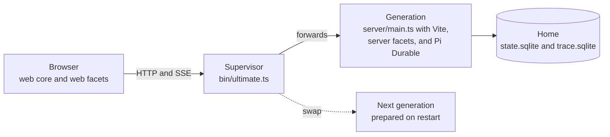

# Architecture

This file says how Ultimate is built: its processes, its layers, where its state lives, and how a change goes live. A code map follows. The mechanics stay in `AGENTS.md` and `docs/`, and this file links to them.

## Processes

- The supervisor, `bin/ultimate.ts`, lives long. It holds the public port and `ultimate.lock`, forwards to one generation, and starts a crashed generation again (`docs/running.md`)
- A generation, `server/main.ts`, is one core process. It embeds Vite, loads the extensions, and opens the Pi Durable harness (`docs/running.md`)
- The browser keeps a live copy of the state from `/api/events`, and it sends commands to `server/api.ts` (`web/src/sdk/store.ts`)
- A preview runs `server/main.ts` with no supervisor, on its own port and home, so it cannot restart (`docs/running.md`)
- `bin/cli.ts` is the emergency terminal agent. It opens no server, no Vite, and no storage (`docs/running.md`)
- Subscriptions, lander checks, and previews run as child process groups (`lib/process-group.ts`)
- The services in the terminal dashboard are status reports, not processes (`README.md`)

## Layers

The layers go from the foundation up. A layer depends only on the layers below it, and `pnpm check` enforces the boundaries between extensions (`AGENTS.md`).

1. **Pi and Pi Durable.** Durable conversations, tasks, hooks, and providers. The packages are pinned, and `patches/` holds local patches ([Borrowed from Pi](../pi-upstream.md))
2. **Core.** `server/` holds the harness, the storage, the HTTP API, discovery, and the Vite hookup. `shared/protocol.ts` holds the contracts between server and browser
3. **Web core.** `web/` holds the surface host and its primitives, the SDK, the transcript, the composer, and the palette
4. **Core tier.** The extensions that are always on. Each depends only on the core tier. [Core tier](../extensions.md#core-tier) names them
5. **Optional built-ins.** The other built-ins. They reach the core tier through points or events
6. **Personal and project extensions.** Folders in `~/.ultimate/extensions/`, and in `<project>/.ultimate/extensions/` for a trusted project. A later folder with the same name replaces an earlier one

Three folders sit beside the layers. `lib/` holds helpers that extensions share and imports no extension. `agents/` and `skills/` hold definitions that Ultimate reads at each use.

## Where state lives

- **The home** of a project, under `~/.ultimate/projects/` unless `ULTIMATE_HOME` sets it (`docs/running.md`):
  - `state.sqlite`: conversations, tasks, and documents of the active chapter (`docs/durability.md`)
  - `trace.sqlite`: the call trace (`server/trace.ts`)
  - `ultimate.lock`, `storage.lock`, and `supervisor.log`: the supervisor and the storage owner (`bin/ultimate.ts`)
  - `project.json` and `conversations.json`: the manifest that other projects read (`docs/durability.md`)
  - `chapters.json`, `chapters/`, and `pending-chapter.json`: the other chapters and a pending switch (`lib/chapters.ts`)
  - `lander/`: the lander's integration checkout (`extensions/workspaces/README.md`)
- **The user layer**, `~/.ultimate/`: `settings.json`, `trust.json`, `secrets.json`, `health.json`, `AGENTS.md`, `skills/`, `agents/`, and `extensions/` (`docs/settings.md`, `extensions/secrets/README.md`, `extensions/health/README.md`)
- **Pi**, `~/.pi/agent/`: logins, models, and settings that Ultimate shares with Pi. Each machine logs in alone (`README.md`)
- **The project**, `.ultimate/` in the repository: committed settings, extensions, agents, skills, and subscriptions (`docs/settings.md`)
- **The UI**: durable UI state in the `ultimate.ui` document of the root conversation. Drafts and scroll positions stay in the browser (`docs/durability.md`)

## How a change goes live

[The layer table](../../AGENTS.md#layers-and-how-they-reload) and [Running the server](../running.md) say how a change to each folder goes live.

## Code map

| Path                      | Role                                                                     | Read first                                        |
| ------------------------- | ------------------------------------------------------------------------ | ------------------------------------------------- |
| `bin/`                    | The supervisor, the terminal dashboard, and the emergency terminal agent | [Running the server](../running.md)               |
| `server/main.ts`          | Starts a generation: HTTP, Vite, extensions, and the harness             | [Running the server](../running.md)               |
| `server/harness.ts`       | Opens Pi Durable on the active chapter                                   | [Durability](../durability.md)                    |
| `server/api.ts`           | HTTP routes, extension actions, UI writes, and the event stream          | [Running the server](../running.md)               |
| `server/discovery.ts`     | Finds built-in, user, and project resources, in order                    | [Discovery and settings](../settings.md)          |
| `server/extensions.ts`    | Loads server facets with their tools, hooks, and actions                 | [Extension mechanics](../extensions.md)           |
| `server/trace.ts`         | The call trace                                                           | [Tracing](../extensions.md#tracing)               |
| `shared/protocol.ts`      | Typed contracts between server and browser                               | `AGENTS.md`                                       |
| `shared/extension-api.ts` | Extension API tokens, the core-tier reader, and `defaultOff`             | [Extension APIs](../extensions.md#extension-apis) |
| `lib/`                    | Shared helpers: exec, git, JSON files, settings, secrets, and chapters   | `AGENTS.md`                                       |
| `web/src/`                | The app shell, the surface host, and the extension registry              | [Writing extensions](../../extensions/README.md)  |
| `web/src/sdk/`            | The SDK that web facets import as `@/sdk`                                | [SDK](../../extensions/README.md#sdk-sdk)         |
| `extensions/`             | The built-ins, each with a README                                        | [Writing extensions](../../extensions/README.md)  |
| `agents/`                 | Built-in agent definitions                                               | [Subagents](../subagents.md)                      |
| `skills/`                 | Built-in skills, `integrate-ultimate` at the snapshot                    | [Discovery and settings](../settings.md)          |
| `.ultimate/`              | The project setup of this repository: checks, push target, review team   | [.ultimate/README.md](../../.ultimate/README.md)  |
| `scripts/`                | Dependency graph check, reset, restore, and machine setup                | `package.json`                                    |
| `lint/`                   | Custom lint rules for boundaries, durability, and fast tests             | `AGENTS.md`                                       |
| `test/`                   | Fast in-process tests, and process tests in `test/e2e/`                  | [Running the server](../running.md)               |
| `patches/`                | Pinned patches to Pi packages                                            | [Borrowed from Pi](../pi-upstream.md)             |
| `docs/`                   | Mechanics for agents that change the code                                | `AGENTS.md`                                       |
| `docs/north-star/`        | This map                                                                 | [North star](../../AGENTS.md#north-star)          |
